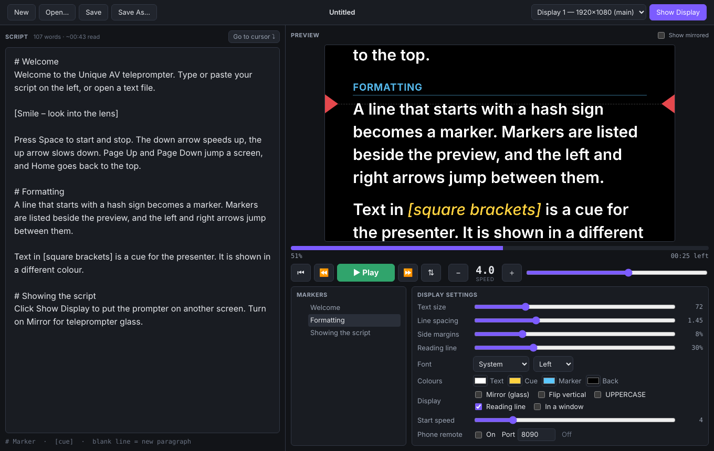

# Unique AV Teleprompter

**Unique AV Teleprompter** is a desktop teleprompter app for reading a show script on air. Write or paste the script, press Space, and the script scrolls smoothly on a full-screen prompter display on any screen. Mirror mode works with teleprompter glass. It runs on macOS and Windows.



## Features

* **Script editor.** Type or paste the script, open a `.txt` or `.md` file (or drop one on the window), and save it back. A word count and reading-time estimate (about 150 words a minute) update as you type. The last script and all settings are restored when the app starts.
* **Prompter display.** Click **Show Display** to put the prompter full screen on the chosen screen: a monitor, a TV, or the screen under the prompter glass. With only one screen, it opens as a floating window. Tick **In a window** to always use a window.
* **Live preview.** The operator window shows exactly what the display shows, wrapped the same way, at the display's aspect ratio. The preview stays readable when the display is mirrored. Tick **Show mirrored** to see it mirrored too.
* **Smooth scrolling.** The speed runs from 0 to 30 in steps of 0.5, and a negative speed scrolls backwards. Scrolling stops automatically at the end, and **END** appears on screen. The speed follows the text size, so the same speed reads the same number of lines whatever size you choose.
* **Reading line.** Red arrows mark the line the presenter reads. Its height is adjustable, and you can hide it.
* **Markers.** A line starting with `#` is a marker, such as `# Segment 2` or `# Guest interview`. Markers appear in the list beside the preview, where you can click one to jump to it. **⏪ / ⏩** (or ← / →) jump to the previous or next marker.
* **Cues.** Text in `[square brackets]`, such as `[Pause]` or `[Roll VT]`, is shown in a different colour so the presenter knows not to read it out.
* **Display settings:** text size, line spacing, side margins, font, alignment, UPPERCASE, and colours for text, cues, markers and background. **Mirror** flips the display horizontally for beam-splitter glass, and **Flip vertical** turns it upside down.
* **Progress.** A progress bar (click it to jump), percentage read and time left at the current speed.
* **Scrubbing.** Scroll the mouse wheel or drag on the preview (or on the display) to move through the script by hand.
* **Go to cursor.** Click a line in the editor and press ⌘J (Ctrl+J on Windows) to scroll the prompter to that line.
* **Clickers and foot pedals.** Presentation clickers that send Page Up/Page Down, arrow keys or Space work out of the box.
* **Phone remote.** Turn on **Phone remote** in the display settings and open the address shown on a phone or tablet on the same Wi-Fi. You get big Play/Pause, speed, marker and jump buttons.
* **Open With.** On a Mac, you can open a text file in the app from Finder (*Open With → Unique AV Teleprompter*).
* **Automatic updates.** The app checks for a new version shortly after it starts and then every 4 hours, and downloads it in the background.
  * It **never restarts during a show**. A green *Restart to update* button appears in the toolbar instead, and it won't install while the prompter is scrolling.
  * If you ignore it, the update installs the next time you quit.
  * Every download is checked against its SHA-512 checksum before it is installed.
  * You can turn automatic checks off, or check now, under *Display settings → Updates*. *Check for Updates…* is also in the app menu on a Mac and the Help menu on Windows.

## Script format

```text
# Opening
Good evening and welcome to the show.

[Smile – camera 2]

Tonight we have three guests…

# Interview
…
```

| You type | You get |
|---|---|
| `# Title` at the start of a line | A marker: a coloured heading you can jump to |
| `[text]` | A cue, shown in the cue colour and italics |
| A blank line | A small gap between paragraphs |

## Keyboard

These keys work in the operator window when the editor isn't focused (press **Esc** to leave the editor) and on the display window.

| Key | Action |
|---|---|
| Space | Play / pause |
| ↓ / ↑ | Faster / slower |
| → / ← | Next / previous marker |
| Page Down / Page Up | Jump forward / back about half a screen |
| Home / End | Top / end of the script |
| R | Reverse direction |
| M | Mirror the display on / off |
| Esc (on the display) | Close the display |

Menu shortcuts work anywhere, even while typing:

| Shortcut (⌘ on Mac, Ctrl on Windows) | Action |
|---|---|
| ⌘↩ | Play / pause |
| ⌘] / ⌘[ | Faster / slower |
| ⇧⌘] / ⇧⌘[ | Next / previous marker |
| ⌘D | Show / hide the display |
| ⌘J | Scroll to the text cursor |
| ⇧⌘M | Mirror |
| ⌘= / ⌘- | Larger / smaller text |
| ⌘N, ⌘O, ⌘S, ⇧⌘S | New, Open, Save, Save As |

## Remote control API

When **Phone remote** is on, the app also accepts plain HTTP requests on the same port (8090 by default). This means Bitfocus Companion (with its *Generic HTTP* module), a Stream Deck or a script can drive it:

```
GET http://<computer-ip>:8090/api/cmd?c=toggle          play / pause
GET http://<computer-ip>:8090/api/cmd?c=speed&v=6       set the speed (v=+1 / v=-1 for relative)
GET http://<computer-ip>:8090/api/state                 { playing, speed, progress, remaining, name, markers }
```

| Command `c=` | Value `v=` | Action |
|---|---|---|
| `play`, `pause`, `toggle` | | Start, stop, toggle |
| `faster`, `slower` | optional step | Change the speed |
| `speed` | number, or `+n` / `-n` | Set the speed |
| `reverse` | | Reverse direction |
| `top`, `end` | | Go to the start / end |
| `next`, `prev` | | Next / previous marker |
| `marker` | number (1 = first) or title | Go to a marker |
| `jump` | stage pixels, `+n` / `-n`, or a percentage like `50%` | Jump |
| `mirror`, `flip` | optional `on` / `off` | Mirror / flip the display |
| `fontsize` | number, or `+n` / `-n` | Text size |

## Installing

Download the installer from the [Releases](https://github.com/Jeansenekal-tech/script-reader/releases) page:

* **Mac:** use the `arm64` `.dmg` for Apple Silicon (M1–M4) or the `x64` one for Intel. Drag the app to Applications. Builds are unsigned unless signing secrets are set up, so the first time, right-click the app and choose **Open**, or run:
  ```sh
  xattr -dr com.apple.quarantine "/Applications/Unique AV Teleprompter.app"
  ```
* **Windows:** run `Unique-AV-Teleprompter-<version>-Setup.exe`. Windows SmartScreen may warn about an unsigned app. Click *More info → Run anyway*.

Every push also builds the installers. You'll find them under *Actions → Build app → (run) → Artifacts*.

## Building from source

```sh
npm install
npm start            # run the app
npm run dist:mac     # .dmg + .zip into dist/ (on a Mac)
npm run dist:win     # .exe installer into dist/ (on Windows)
```

### Publishing a release (and auto-updates)

On GitHub, go to **Actions → Build app → Run workflow**. Type a version such as `1.0.1` (higher than the last one) and, optionally, what's new, then click **Run workflow**. In a few minutes it:
1. Builds the Mac (Apple Silicon and Intel) and Windows installers with that version number.
2. Publishes a GitHub Release containing them and an `update.json` manifest, which lists each package with its size and SHA-512 checksum.

Installed copies find the new version within 4 hours, or straight away with *Check for Updates…*. Pushing a `v*` tag does the same thing. To sign the Mac app, add the `MAC_CERT_P12_BASE64` and `MAC_CERT_PASSWORD` repository secrets.

How updates install:
* **Mac:** the app downloads the `.zip` for its architecture, verifies it, and swaps the app in place after quitting. This works for signed and unsigned builds alike. The app must be in a folder it can write to, such as Applications. If it is run from the disk image or another read-only location, the app opens the new `.dmg` in the browser instead.
* **Windows:** the app downloads the Setup `.exe`, verifies it, and runs it silently after quitting.

The app looks for releases at `updateUrl` in `package.json`, which points to this repository's latest release. Updates only work while the repository is public, because GitHub doesn't serve release files from private repositories without signing in.

### Tests

```sh
node test/engine-test.cjs                  # scroll engine logic
node test/updater-test.mjs                 # versions, update.json, verified download against a local server
node test/ui-test.mjs                      # operator + display pages in headless Chromium (needs playwright)
xvfb-run -a node test/electron-smoke.mjs   # the full app: windows, file open, phone remote, saving
```

## How it works

```
main.js              Electron main: windows, display placement, menus, file open/save, IPC
main/engine.js       Script, settings and scroll transport (no Electron; unit-tested)
main/remote.js       Phone remote page + HTTP API
main/updater.js      Auto-update (manifest check, verified download, install on quit)
scripts/             update.json generator, ad-hoc Mac signing hook
preload.js           window.prompter bridge for the operator and display windows
renderer/stage.js    Shared prompter view: script → layout, scrolling, mirror, reading line
renderer/operator.*  Operator window: editor, preview, transport, settings
renderer/display.html  Talent display
renderer/remote.html   Phone remote
```

The main process keeps the scroll state: position, speed and whether it is playing. Each view animates locally from that state at the screen's refresh rate, so the preview and the display stay in step without sending a message every frame. All views lay the script out on the same 1600-pixel-wide stage and scale it to fit, so a line wraps at the same word everywhere.
